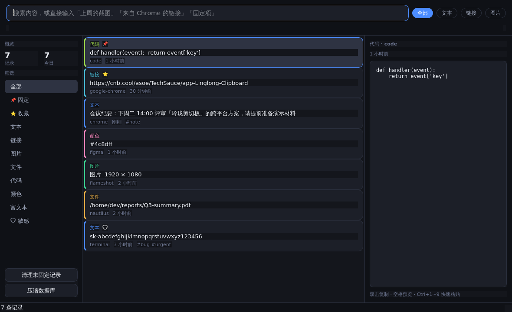
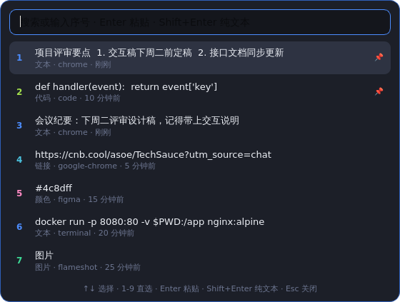
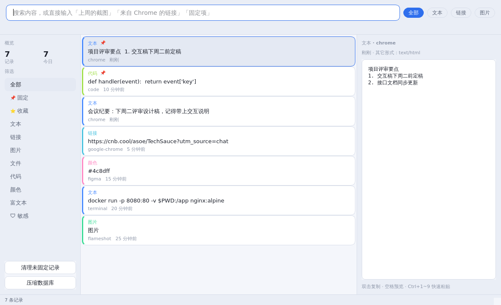
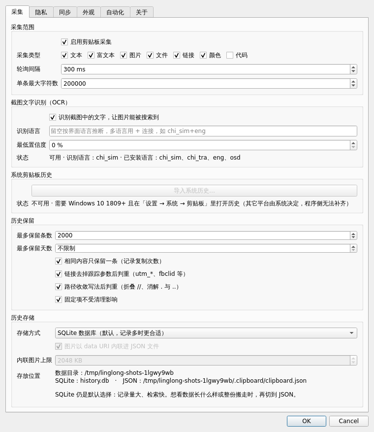

# 玲珑剪切板

> 跨平台智能剪切板 —— 本地优先、语义检索、可编程转换

[](.github/workflows/build.yml)
[](LICENSE)
[](pyproject.toml)

玲珑剪切板是一款面向重度复制粘贴用户的桌面剪贴板管理器。它把「历史记录」做成可检索、
可加工、可跨设备流转的知识库，而不是一个简单的文本列表。

支持 **Windows / Linux / macOS**，三平台共用一份代码，通过平台适配层收敛差异。

### 界面预览

主界面（深色主题）—— 左侧筛选、中间卡片列表、右侧预览：



快速粘贴浮层（`Ctrl+Shift+V`）—— 按序号直选，回车即粘贴：



浅色主题：



设置页 —— 采集、OCR、同步、隐私都在这：



---

## 为什么再造一个剪贴板

现有工具大多停在「多存几条历史 + 关键词过滤」。真实使用中的痛点其实是另外三件事：

1. **想不起来关键词**。要找的是「上周从 Chrome 复制的那张截图」，
   但你不记得它上面写了什么。所以需要按意图检索，而不是按文本匹配。
2. **复制之后还要加工**。粘一段 JSON 想格式化、贴一堆路径想只留文件名、
   复制 URL 想去掉跟踪参数 —— 通常得开编辑器或在线工具。
3. **隐私黑箱**。密码、密钥、身份证号被无差别记进历史库，
   还可能同步到云端，事后无从知晓。

玲珑剪切板针对这三点分别给出了方案。

---

## 核心能力

### 一、语义检索，不靠记关键词

搜索框直接接受自然语言：

| 输入 | 理解结果 |
| --- | --- |
| `上周的截图` | 类型=图片，时间=上周 |
| `来自 Chrome 的链接` | 类型=链接，来源含 chrome/google-chrome/chromium |
| `固定项` | 只看已固定 |
| `收藏的代码` | 类型=代码，且已收藏 |
| `最近的图片` | 类型=图片，时间=近 3 天 |

识别出的条件会显示在搜索框下方（「已理解：时间：上周 · 类型：截图」），
再也不用猜为什么没搜到。

排序不是单纯按时间，而是四个信号加权：

- **全文相关度**（FTS5，`trigram` 分词器对中文与代码片段友好）
- **时间衰减**（半衰期 7 天，权重可调）
- **使用频次**（取对数，避免高频项长期压制其它结果）
- **固定 / 收藏加权**

### 二、33 种内置转换，复制完就地加工

右键任一记录 → 「转换为…」，按内容类型自动列可用动作，共 5 大类 33 个：

| 分类 | 示例 |
| --- | --- |
| 数据 | 格式化 / 压缩 JSON、JSON→YAML、CSV→JSON、CSV→Markdown 表格 |
| 编码 | Base64 编解码、SHA-256、MD5 |
| 文本 | 按行排序 / 去重 / 加行号、压缩空白、大小写互换、统计字数 |
| 命名 | snake_case、camelCase、PascalCase、kebab-case |
| 路径 | 只留文件名、批量加引号、Shell 转义 |
| 链接 | URL 编解码、去掉 `utm_*` / `fbclid` 等跟踪参数 |
| 提取 | 提取邮箱、链接、数字、IP |

转换结果先展示再确认，还能**链式叠加**（先格式化 JSON 再压缩），
不会直接覆盖你的剪贴板。

### 三、可编程自动化规则

规则是纯 JSON，可热加载，无需改代码：

```json
[
  {
    "name": "自动压缩 JSON",
    "enabled": true,
    "kinds": ["text", "code"],
    "pattern": "^\\s*[\\{\\[]",
    "min_length": 20,
    "actions": ["json.format"],
    "trigger": "auto"
  },
  {
    "name": "粘贴前清理链接",
    "kinds": ["link"],
    "contains": "utm_",
    "actions": ["url.strip_tracking"],
    "trigger": "manual"
  }
]
```

`trigger` 为 `auto` 时，采集到匹配内容就自动加工；
`actions` 写多个动作会按顺序链式执行。

### 四、截图里写的字，也能被搜到

剪贴板里很大一部分是截图。「上周那张写着地址的图」用关键词搜索是找不到的，
因为图片里没有可检索的文本。

开启 OCR 后，截图入库时自动识别其中的文字并写入检索索引：

- 搜索框输入截图里的任意词即可命中，结果与普通记录一样参与排序
- 列表里直接显示识别出的文字摘要，不用点开就知道是哪张图
- 识别出的敏感内容（密钥、身份证、手机号）同样会被隐私策略拦截，
  不会因为「藏在图片里」就漏过去

默认使用系统 `tesseract`，不引入任何 Python 依赖，也不需要下载模型：

```bash
# Debian / Ubuntu
sudo apt-get install tesseract-ocr tesseract-ocr-chi-sim tesseract-ocr-chi-tra

# macOS
brew install tesseract tesseract-lang

# Windows：从 UB-Mannheim 发行版安装后把目录加入 PATH
```

**没装 tesseract 会怎样？** 不会报错也不会挡住启动，截图照常记录，
只是搜不到里面的文字。设置页的「截图文字识别」会直接告诉你当前是否可用、
装了哪些语言，不用去猜。

识别语言可配置（`ocr.languages`），留空则按界面语言推断；
多语言用 `+` 连接，例如 `chi_sim+eng` 适合中英混排的截图。
识别是异步的，不阻塞采集；同一张图有缓存，不会重复识别。

### 五、隐私是默认值，不是可选项

- **密码管理器直接跳过**：内置识别 1Password、Bitwarden、KeePass、LastPass 等 14 种，
  还可自加黑名单。
- **敏感内容不落盘**：识别出私钥、API Key、JWT、身份证、银行卡、密码字段后，
  **默认直接丢弃**，连历史都不进（可在设置里改成限时保留）。
  PEM 私钥是硬拦截，不给配置机会。
- **按需脱敏**：开启后，复制到外部时敏感片段替换为 `[已脱敏:密码字段]`，
  字段名保留可读性。
- **本地优先**：数据只存本机 SQLite，不上传任何服务器。
- **同步内容加密**：跨设备同步可选 Fernet 对称加密（PBKDF2 派生的密钥）。
- **敏感项不进同步**：即使本地保留，也不导出。

### 六、三平台原生适配

| 能力 | Windows | Linux (X11) | Linux (Wayland) | macOS |
| --- | --- | --- | --- | --- |
| 剪贴板采集 | ✅ 事件驱动 | ✅ 轮询 | ✅ 轮询 | ✅ 轮询 |
| 来源应用识别 | ✅ Win32 | ✅ Xlib/xdotool | ⚠️ 受限 | ✅ osascript |
| 主选择区（PRIMARY） | — | ✅ | ✅ wl-paste | — |
| 安全粘贴标记 | ✅ 系统级 | — | — | — |
| 全局快捷键 | ✅ RegisterHotKey | ✅ XGrabKey | ⚠️ 需桌面环境绑定 | ⚠️ 需 pyobjc |

所有原生能力失败都会**优雅降级**（退回 Qt 剪贴板 + 轮询 + 应用内快捷键），
不会因为缺依赖而无法启动。

Windows 上走 `AddClipboardFormatListener` 事件驱动，避免轮询空转；
写入时附加 `ExcludeClipboardContentFromMonitorProcessing`，
让敏感内容不进系统剪贴板历史。

### 七、跨设备同步，不要中心服务器

两种模式，都不经过第三方服务器：

- **共享文件夹**：把同步目录指向 OneDrive / iCloud / Syncthing / NFS 即可。
  每台设备只追加自己的日志文件，天然避免并发写冲突；
  日志按「4 字节长度 + 载荷」分块，单块损坏不影响其余记录。
- **局域网直连**：同一网段内设备互连，适合「家里几台机器」但不依赖网盘。
  采用**拉取模型**：每台设备只暴露一个只读接口，自己决定何时去拉对端，
  因此不需要处理对端离线，也不会有并发写同一份数据的问题。

局域网模式的三条安全约定：

| 措施 | 说明 |
| --- | --- |
| 共享口令 | 同网段不等于可信（咖啡馆 Wi-Fi）。不设口令时同网段任何人都能读取你的剪贴板，设置页会明确提示 |
| 只读接口 | 接收方主动拉取，发送方不提供写入接口，攻击面只剩「读取」一条路径 |
| 内容过滤 | 敏感项与图片一律不外发，与共享文件夹模式走同一份隐私判定 |

发现方式默认是**手动填对端地址**（支持 `host` 或 `host:port`）；
开启「自动发现」后会用 UDP 广播互相通告，但部分 Wi-Fi 会拦截组播，
所以默认关闭。加密仍复用 Fernet，两端口令一致才能解密。

---

## 安装

### 从源码运行（开发）

```bash
git clone https://github.com/linglong/clipboard.git
cd clipboard
pip install -r requirements.txt

# 直接运行
python linglong_clipboard.py
```

### 安装为命令

```bash
pip install -e .
linglong-clipboard          # 或简写 llclip
```

### 下载预编译版本

到 Releases 页面下载对应平台的文件：

- **Windows**：`玲珑剪切板.exe`，双击即用，无需安装 Python
- **macOS**：`玲珑剪切板.app`
- **Linux**：`linglong-clipboard`，`chmod +x` 后运行

### Linux 桌面集成

```bash
mkdir -p ~/.local/share/applications
cat > ~/.local/share/applications/linglong-clipboard.desktop <<'EOF'
[Desktop Entry]
Type=Application
Name=玲珑剪切板
Comment=跨平台智能剪切板
Exec=linglong-clipboard
Icon=edit-paste
Categories=Utility;
StartupNotify=false
EOF
```

**Wayland 全局快捷键**：Wayland 出于安全设计不允许应用抓取全局按键，
请在桌面设置里把自定义快捷键绑定到 `linglong-clipboard --quick`：
GNOME 见「设置 → 键盘 → 自定义快捷键」，KDE 见「系统设置 → 快捷键」。

---

## 使用

### 交互一览

| 操作 | 快捷键 |
| --- | --- |
| 唤起快速粘贴浮层 | `Ctrl+Shift+V`（全局） |
| 主窗口内搜索 | `Ctrl+F` |
| 复制选中项（纯文本） | `Enter` / `Ctrl+C` |
| 直接粘贴到上个窗口 | 双击记录 |
| 快速粘贴浮层里按序号直选 | `1`–`9` |
| 浮层内粘贴 / 纯文本粘贴 | `Enter` / `Shift+Enter` |
| 固定 / 收藏 | `Ctrl+P` / `Ctrl+D` |
| 快速粘贴第 N 条 | `Ctrl+1`–`Ctrl+9` |
| 删除 | `Delete` |
| 关闭 / 隐藏窗口 | `Esc` |

### 命令行

图形界面之外保留了完整的 CLI，SSH 会话或排查问题时很有用：

```bash
linglong-clipboard --list -n 20              # 列出最近 20 条
linglong-clipboard --search '上周的截图'      # 自然语言检索
linglong-clipboard --search 'cnb' --kind link # 按类型收窄
linglong-clipboard --get 12                  # 输出第 12 条完整内容
linglong-clipboard --list --json             # JSON 输出，便于脚本处理
linglong-clipboard --stats                   # 统计与检索能力
linglong-clipboard --clear                   # 清理未固定记录
linglong-clipboard --compact                 # 压缩数据库
linglong-clipboard --quick                   # 唤起快速粘贴浮层
linglong-clipboard --minimized               # 启动后最小化到托盘
linglong-clipboard --storage-status          # 历史存在哪（SQLite 还是 JSON）
linglong-clipboard --where                   # 只输出数据目录路径
linglong-clipboard --storage json            # 切换存储方式
linglong-clipboard --storage-migrate         # 把记录搬到另一种存储（原数据保留）
```

### 数据存放位置

历史记录有**两种存储方式**，都在同一个数据目录下，一处就能看全：

| 存储方式 | 文件 | 适合谁 |
| --- | --- | --- |
| SQLite（默认） | `history.db` | 记录上万条以上、在意检索速度 |
| JSON 单文件 | `.clipboard/clipboard.json` | 想看数据长什么样、拷一个文件就搬走 |

数据目录按平台约定：

| 平台 | 历史文件 |
| --- | --- |
| Windows | `%APPDATA%\LinglongClipboard\history.db`　或　`…\.clipboard\clipboard.json` |
| macOS | `~/Library/Application Support/LinglongClipboard/` |
| Linux | `~/.local/share/linglong-clipboard/`（配置在 `~/.config/linglong-clipboard/`） |

选 JSON 方式时，历史落在数据目录下的 `.clipboard/clipboard.json`；
选 SQLite 时是数据目录下的 `history.db`。两者可以共存，互不覆盖。

图片附件存在 `images/` 子目录，数据库只存相对路径，整体搬走目录也不会失联。
JSON 方式下图片默认**内联进历史文件**（data URI），
所以单个 `clipboard.json` 拷到别的机器，图片也一起跟着走；
超过 2MB 的大图仍留在 `images/`（可在设置里调上限）。

```bash
linglong-clipboard --storage-status            # 现在存在哪
linglong-clipboard --where                     # 只输出数据目录，便于脚本取用
linglong-clipboard --storage json              # 切到 JSON 单文件
linglong-clipboard --storage json --storage-migrate   # 切过去，并把已有记录搬过去
```

**切换存储不会丢数据**：`--storage-migrate` 只做复制，原文件保留，
后悔了把 `--storage` 切回去即可。也可以在设置页「采集 → 历史存储」里改。

### JSON 格式长什么样

刻意做成一眼能读、能手改的样子：

```json
{
  "version": 1,
  "updated_at": 1790497962.232,
  "items": [
    {
      "id": 1,
      "kind": "link",
      "content": "https://cnb.cool/x",
      "created_at": 1790497962.23,
      "preview": "https://cnb.cool/x",
      "source_app": "chrome",
      "hash": "c5cc4dd941e0914b",
      "pinned": true,
      "tags": ["link"],
      "metadata": { "host": "cnb.cool" }
    }
  ],
  "meta": {}
}
```

- 空字段不写进文件（没有 `html`、`files` 就不出现），文件不会被一堆 `""` 撑大
- 中文不转义，直接 `grep 玲珑 clipboard.json` 就能搜
- 每条记录都有 `hash`，可用来去重、也可作为跨设备对账依据

设置环境变量 `LINGLONG_CLIPBOARD_HOME` 可覆盖全部路径（便携模式）；
单独指定 `LINGLONG_CLIPBOARD_JSON_HOME` 可以把 JSON 历史放到 U 盘或同步盘。

### 该选哪种存储

| | SQLite | JSON 单文件 |
| --- | --- | --- |
| 记录量 | 十万级无压力 | 几千条以内（每次写入重写整份文件） |
| 检索 | FTS5 全文索引，毫秒级 | 进程内扫描 + 字段权重打分 |
| 可读/可手改 | 二进制 | 纯文本 |
| 备份搬运 | `history.db` + `-wal`/`-shm` | 一个文件 |
| 崩溃安全 | WAL 日志 | 临时文件 + 原子替换 |

**默认仍是 SQLite**，因为剪贴板历史天然会涨到上万条；
JSON 是给「我要看得见我的数据」这个需求准备的，不是性能方案。

---

## 开发

### 环境准备

```bash
pip install -r requirements-dev.txt
```

Linux 还需要 Qt 的图形运行库：

```bash
sudo apt-get install -y libegl1 libglib2.0-0 libxkbcommon-x11-0 libdbus-1-3

# 想跑 OCR 的真机用例，还需要 tesseract
sudo apt-get install -y tesseract-ocr tesseract-ocr-chi-sim
```

> OCR 测试默认用桩后端，**不依赖 tesseract**；
> 只有检测到真实可执行文件时才会补跑一组真机用例。

### 跑测试

```bash
pytest tests/ -v                                    # 全部测试
pytest tests/ --cov=linglong_clip --cov-report=html # 带覆盖率
QT_QPA_PLATFORM=offscreen pytest tests/test_ui.py   # 无头环境跑界面测试
```

546 个用例，覆盖核心逻辑、平台适配、界面组件与端到端流程。
界面测试统一走 Qt 的 `offscreen` 平台，无需真实显示器，CI 里也能跑。

局域网同步的测试**用真实 socket 在 `127.0.0.1` 上起服务**（端口用 0 让系统分配，
避免互相抢端口），验证的是端到端链路而不是对 mock 的断言。

### 打包

```bash
python packaging/build.py            # 单文件
python packaging/build.py --onedir   # 目录模式（启动更快）
```

> PyInstaller 不支持交叉编译。Windows 的 `.exe` 必须在 Windows 上打，
> macOS 的 `.app` 只能在 macOS 上打。CI 用三平台矩阵解决（`.github/workflows/build.yml`）。

### 代码结构

```
src/linglong_clip/
├── core/                    # 与界面无关的核心逻辑（可独立测试）
│   ├── models.py            #   数据模型与内容指纹
│   ├── storage.py           #   SQLite + FTS5 持久化与检索
│   ├── repository.py        #   JSON 单文件存储（与 storage 接口对齐）
│   ├── classify.py          #   类型识别、敏感检测、标签抽取
│   ├── privacy.py           #   隐私策略与脱敏
│   ├── semantic.py          #   意图解析与多信号排序
│   ├── collector.py         #   采集管线：识别→风控→去重→落库
│   ├── monitor.py           #   剪贴板监听调度
│   ├── automation.py        #   33 个转换器 + 规则引擎
│   ├── ocr.py               #   截图文字识别（tesseract 后端 + 降级）
│   ├── sync.py              #   共享文件夹同步与加密
│   └── lan_sync.py          #   局域网直连同步（拉取模型 + 鉴权）
├── platform/                # 平台差异收敛在这里
│   ├── base.py              #   后端接口与能力矩阵
│   ├── windows.py           #   Win32 ctypes（零第三方依赖）
│   ├── linux.py             #   X11 / Wayland 双栈
│   └── macos.py             #   osascript
├── ui/                      # Qt 界面层
│   ├── application.py       #   装配与事件路由、线程调度
│   ├── main_window.py       #   主窗口
│   ├── quick_paste.py       #   快速粘贴浮层
│   ├── item_card.py         #   列表卡片
│   ├── settings_dialog.py   #   设置
│   ├── transform_window.py  #   转换结果
│   ├── clipboard_qt.py      #   Qt 剪贴板适配
│   ├── hotkeys.py           #   全局快捷键
│   ├── tray.py              #   系统托盘
│   └── theme.py             #   主题与样式表
└── utils/                   # 配置、日志、路径
```

分层约定：**`core/` 不导入任何 Qt**。这样核心逻辑能在无图形环境下测试，
也让将来换界面框架的代价可控。平台差异一律走 `platform/`，
界面代码里不出现 `if sys.platform`。

更多设计说明见 [docs/architecture.md](docs/architecture.md)。

---

## 技术选型说明

几个关键决策及其理由，便于评估与二次开发：

| 决策 | 理由 | 放弃的方案 |
| --- | --- | --- |
| **PySide6**（LGPL） | 一套代码覆盖三平台，原生外观，控件与事件模型成熟 | Electron（体积 100MB+、内存占用高）；Tauri（各平台 WebView 行为不一致）；Tkinter（无托盘、无原生通知） |
| **规则 + 正则做内容识别** | 零延迟、可解释、可单测；剪贴板是高频操作，毫秒级延迟可感知 | 加载 NLP 模型（冷启动数秒、体积数百 MB）；调用云 API（隐私不可接受） |
| **SQLite + FTS5** | 零配置、单文件、`trigram` 分词器对中文与代码友好；LIKE 兜底保证不中断 | 独立检索引擎（部署负担）；纯内存索引（重启丢数据） |
| **轮询而非纯事件驱动** | 三平台里只有 Windows 有可靠通知，轮询 + 指纹比对是唯一通用方案；300ms 间隔 CPU 占用可忽略 | 各平台写原生扩展（维护成本远超收益） |
| **代码绘制图标** | 任意 DPI 都清晰，不必维护多套位图，打包体积更小 | 打包 png/ico/icns 三套资源 |
| **同步走共享文件夹 + 局域网直连** | 用户已有同步盘时用文件夹；没有网盘时同网段直连。两者都不经过第三方服务器，省去账号体系与运维成本，也不引入数据留存方 | 自建中心服务器（运维成本 + 隐私责任）；只做文件夹模式（无网盘的用户用不了） |
| **OCR 调 tesseract 命令行** | 剪贴板 OCR 是低频后台任务，精度够用即可；直接 `subprocess` 比 `pytesseract` 少一层依赖，更好控制超时与降级 | PaddleOCR/EasyOCR（数百 MB 模型 + 深度学习运行时）；云 OCR（隐私不可接受） |
| **局域网用标准库 `http.server`** | 同步是几十毫秒级的小请求，标准库够用；少一个依赖就少一份打包体积与供应链风险 | aiohttp/requests（为一个功能引入整套 HTTP 栈） |
| **局域网用拉取而非推送** | 只需暴露只读接口，自己决定何时拉取；天然免去并发写与对端离线处理 | 推送模型（要处理对端离线队列、写入冲突） |

---

## 已知限制

- **Wayland 全局快捷键**：Wayland 不允许应用抓取全局按键，需在桌面环境里自行绑定。
- **Wayland 来源应用识别**：协议未暴露前台窗口信息，来源会显示为未知。
  这是 Wayland 的隐私设计，非本工具缺陷。
- **macOS 全局快捷键**：需要 `pyobjc` 且需授予辅助功能权限，未满足时降级为应用内快捷键。
- **复制后自动粘贴**：Linux 下依赖 `xdotool`，Wayland 不支持。
- **图片不同步**：为避免同步目录膨胀，图片默认只在本地，不参与跨设备流转。
- **OCR 依赖系统 tesseract**：未安装时截图照常记录，只是搜不到图中的文字。
  手写体、低分辨率与复杂排版的识别率有限，属通用 OCR 的固有局限。
- **局域网发现依赖 UDP 广播**：部分 Wi-Fi 会拦截组播/广播，
  此时自动发现失效，需手动填写对端地址。局域网模式默认不设防，
  在不可信网络务必设置共享口令。

---

## 贡献

欢迎提交 Issue 与 PR。动手前请留意：

- 新增核心逻辑请同步补 `tests/` 下的用例（核心模块覆盖率维持在 85% 以上）
- `core/` 下不要导入 Qt
- 平台相关代码放 `platform/`，并更新 README 的能力矩阵
- 原生能力都要有降级路径，不能让应用启动失败

---

## 许可

[MIT](LICENSE)
